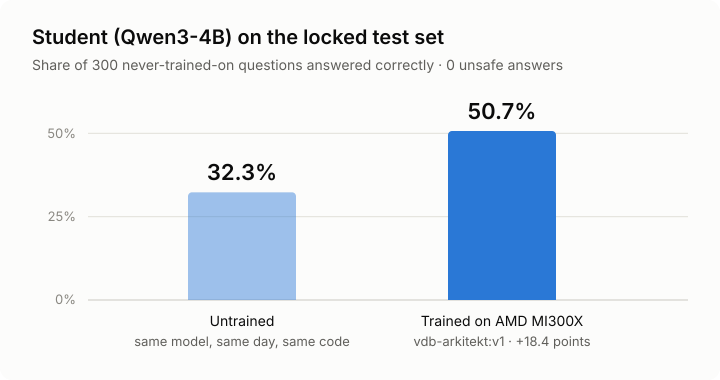
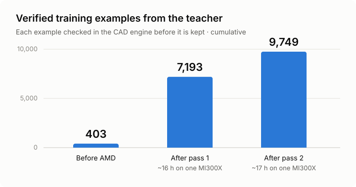

# VDB AI architect: training results on AMD Instinct MI300X

VDB is a Swedish house-design CAD application with an AI architect. A user describes a change in plain Swedish, for example
"move the kitchen window 40 cm east" or "make bedroom 1 a metre wider". The assistant then makes exactly that change in the
drawing: the right object, the right place, the right size. It never makes an unsafe structural change without confirmation.

The goal is a **small local model (Qwen3-4B) inside the app**, taught by a larger teacher model. This repository reports what
we trained on the **AMD Developer Cloud (one AMD Instinct MI300X, 192 GB, ROCm)** in November 2026, and what it gave.

This repository holds results only. The application code, the training data and the test questions are not published.





## Results

| Measure | Before | After | Note |
|---|---|---|---|
| Student (Qwen3-4B) on the locked test set, 300 questions | 32.3 % | **50.7 %** | Untrained baseline measured the same day with the same code; 0 unsafe answers |
| Verified training examples | 403 | **9,749** | Every example checked in our CAD engine before it is kept |
| Questions in the training bank with an approved answer (25,761) | – | **15,796 (61.3 %)** | 9,481 with examples + 6,315 solved by rules |
| Cost per verified example | – | **≈ $0.007** | ≈ $66 of GPU time / ≈ 9,350 new examples |

The **locked test set** is 300 questions that the models are never trained on. It never leaves our own machine. Its question
list is frozen, so new questions in the bank cannot swap it.

### Teacher rounds

Each round retrains the teacher on all verified examples. The teacher then answers every question that is still unsolved,
and the answers are judged at home in the real engine.

| Round | Teacher | Unsolved before | New verified examples | Hit rate |
|---|---|---|---|---|
| 4 | Qwen3-30B-A3B + LoRA 4 | 8,999 | 1,153 | 12.8 % |
| 5 | Qwen3-30B-A3B + LoRA 5 | 7,577 | 803 | 10.6 % |
| 6 | Qwen3-30B-A3B + LoRA 6 | 6,971 | running | – |

Rounds 1–3 built the first 7,193 examples from scratch.

## How the MI300X is used

```
 Teacher: Qwen3-30B-A3B            Our CAD engine              Student: Qwen3-4B
 LoRA in bf16, no quantization  ->  every answer verified   ->  trained on verified
 served with vLLM on ROCm           (right change? safe?)       examples, runs locally
```

| | |
|---|---|
| Hardware | 1 × AMD Instinct MI300X, 192 GB (AMD Developer Cloud) |
| Software | ROCm, PyTorch, Hugging Face transformers + peft, vLLM (rocm/vllm image) |
| Teacher training | LoRA rank 16, bf16, max length 8,192 tokens, 2 epochs; peak memory 78 GB; 7.2–8.9 s per step |
| Teacher serving | vLLM, 128 parallel sequences, ≈ 26 answers per second |
| Student training | Qwen3-4B, LoRA rank 16 on all 7 projection modules, 2 epochs, 116 min (≈ $4) |
| Operation | Unattended overnight runs; results copied home with checksums; the instance is destroyed when done |

| Session | Duration | ≈ Cost | What ran |
|---|---|---|---|
| 1 | ≈ 16 h | ≈ $32 | Teacher LoRA 1–3, teacher runs 1–7 |
| 2 | ≈ 17 h | ≈ $34 | Student v1, teacher LoRA 4–5, teacher rounds 4–5 |
| 3 | ≈ 8–9 h (running) | ≈ $17 | Teacher LoRA 6 on all 9,416 examples, round 6 |

Costs are hours × $1.99 per hour.

## Measuring honestly

- **Baseline on the same day, same code.** The 32.3 % comes from the untrained student measured alongside the trained one. Older numbers measured with older code are not compared.
- **Validation by question family, not by row.** Templates that differ only in numbers or room names, such as "move the door between Kitchen and Hall to E=120 N=340 cm", are one family. We found that our first split leaked them across training and validation. It now holds out whole families: 7,850 families, with no user text in both parts.
- **Cheap test first, then the real check.** A result only counts after it holds in the real CAD engine on the locked test set.
- **Root causes, not retries.** The teacher runs exposed bugs in the app itself, which were then fixed. Moving doors and windows to a point went from 47 to 104 of 110 cases. Odd compass-direction phrasings went from 166 to 207 of 209.

## Where we are going

- Student: from 50.7 % toward **70 %** on the locked test set, always with **0 unsafe answers**.
- The local model replaces the paid cloud API for every drawing chat in the app.
- Next: more teacher rounds on the remaining ≈ 7,000 hard cases, an 8B student compared against the 4B, and teacher training for 13 new CAD tools that today block about 1,200 questions.
- **One step at a time: Sweden first** (Swedish language, building rules and drawing conventions), **then the Nordics, then Europe, then the world.**

---

Results as of 2026-11-21. Figures are counted from the raw run logs and example files.
